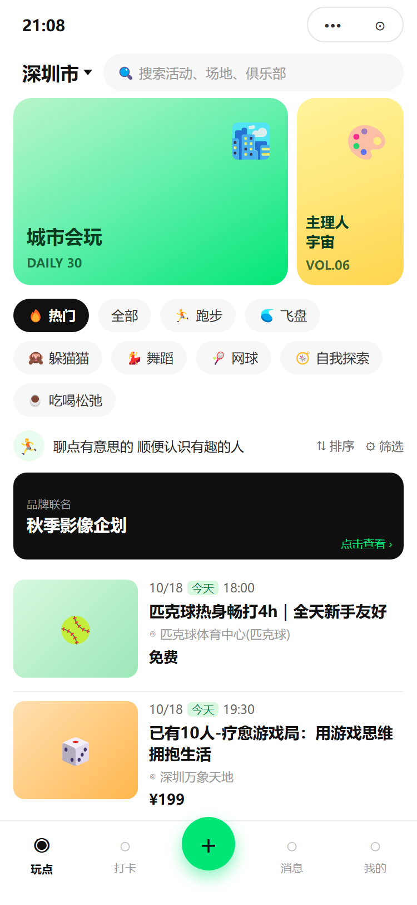
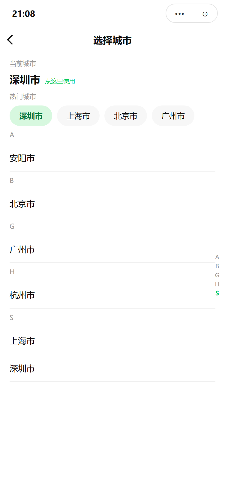
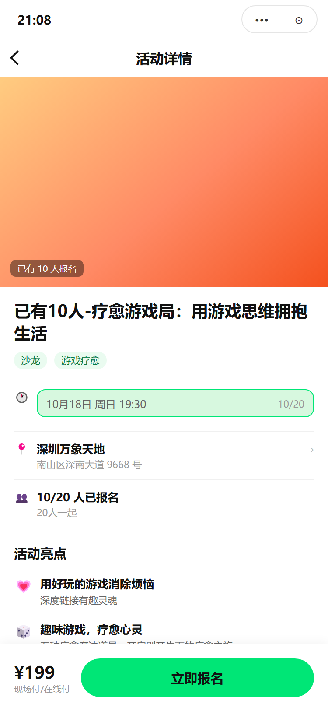
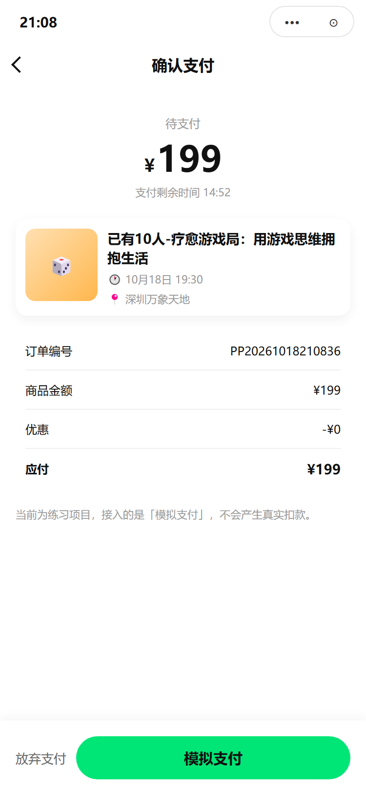
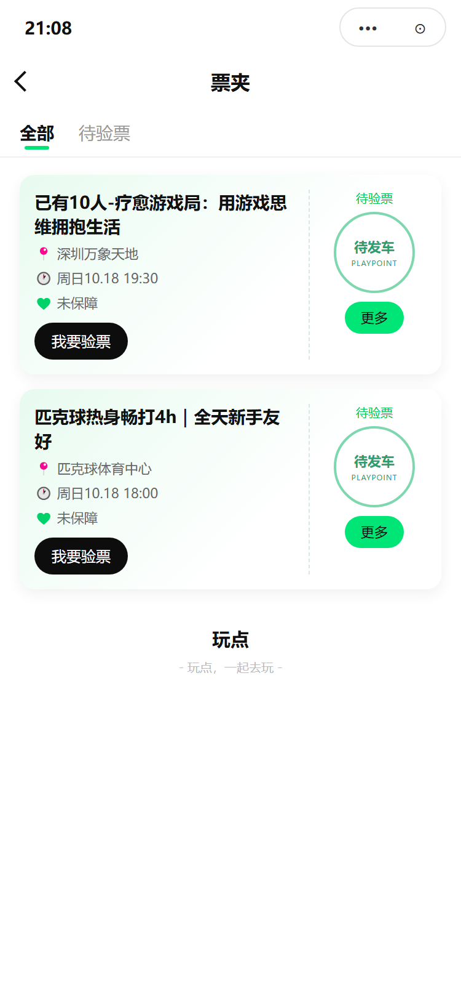
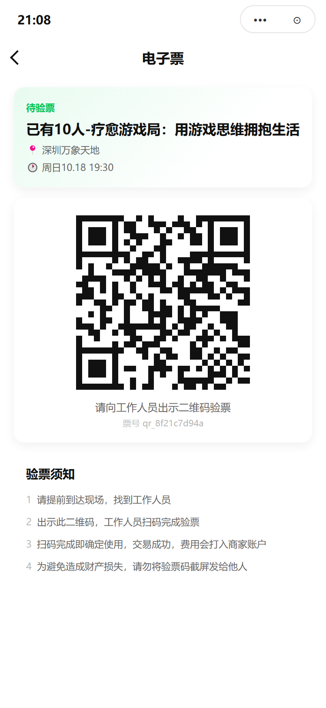

# PlayPoint · 玩点

> 城市兴趣社交小程序：发现同城活动 → 报名 → 现场打卡挑战 → 攒奖牌与个人兴趣档案。
> 微信小程序（原生 TS）+ NestJS 后端 + Prisma，可在**纯 Mock 模式**下真机跑通全链路。

[](./LICENSE)
[](#)
[](#)
[](#)

## 界面

| 发现（首页） | 城市选择 | 活动详情 |
| --- | --- | --- |
|  |  |  |
| 运营双卡 + 分类筛选 + 活动流，支持下拉刷新与游标分页 | 当前城市 / 热门城市 / 首字母分组 + 右侧索引 | 场次切换、亮点、主办方、退款说明、同城推荐 |

| 收银台 | 票夹 | 电子票 |
| --- | --- | --- |
|  |  |  |
| 15 分钟倒计时 + 模拟支付（不产生真实扣款） | 全部 / 待验票筛选，票卡含邮戳与验票入口 | 二维码验票（占位点阵）+ 验票须知 |

> 上图为用项目真实设计令牌与页面结构渲染的**界面示意**（`docs/preview/screens.html`），非真机截图。
> 重新生成：`powershell -NoProfile -ExecutionPolicy Bypass -File docs/preview/shot.ps1`

## 功能

| 模块 | 已实现 | 说明 |
| --- | --- | --- |
| 启动与合规 | ✅ | 冷启动拉配置、隐私弹窗（版本号比对）、静默微信登录、token 持久化 |
| 发现 | ✅ | Banner 运营位、9 个分类、排序、游标分页、骨架/空/错误态 |
| 城市 | ✅ | 手动选城（不依赖定位接口），热门 + 字母分组 + 索引，切换后首页自动刷新 |
| 活动详情 | ✅ | 场次选择、名额校验、亮点、主办方、退款说明、同城推荐、打开地图 |
| 报名 | ✅ | 报名弹层（昵称/性别）、重复报名拦截、免费直接出票、付费生成待支付订单 |
| 支付 | ✅ | 收银台倒计时、模拟支付、支付结果页 |
| 票务 | ✅ | 票夹列表（全部/待验票）、电子票二维码、验票须知 |
| 挑战赛 | 🚧 | 打卡列表已接（封面/日期/奖牌提示），详情与打卡提交在 M3 |
| 消息 / 我的 | 🚧 | Tab 与静态信息架构已就位，会话与资料编辑在 M2 |
| Mock 数据层 | ✅ | 与接口契约同构的本地实现，`develop` 默认开启，我的页可一键开关 |

## 技术栈

- **小程序**：原生 WXML/WXSS + TypeScript，自定义 tabBar，无第三方 UI 库
- **后端**：NestJS 10 + Prisma 5 + PostgreSQL 15（本地用 Podman 起容器），Redis 预留
- **契约**：Swagger（`/docs`），响应包 `{ code, message, data, traceId }`，字段与前端类型同源
- **调试**：请求层内建 Mock 路由，真机预览无需内网穿透

## 目录结构

```
playpoint-gbc/
├── miniprogram/            小程序
│   ├── pages/              首页 / 活动详情 / 收银台 / 票夹 / 电子票 / 城市 / 打卡 / 消息 / 我的
│   ├── components/         nav-bar、privacy-modal
│   ├── services/           request（含 mock 分流）、api、auth、mock/
│   ├── stores/             轻量 store（app / user）
│   ├── styles/             设计令牌与工具类
│   └── config/env.ts       环境与 mock 开关
├── backend/                NestJS + Prisma
│   ├── src/                auth / app-info / home / activity / order / ticket / campaign
│   └── prisma/             schema、migrations、seed
├── data/doc/               产品、设计、前端、后端、交付、M0 全套文档
├── docs/                   README 用截图与静态预览页
└── .work/                  本地工具脚本（不提交）
```

## 快速开始

### 1. 只看界面（无需后端，推荐）

1. 微信开发者工具「导入项目」，目录选 `miniprogram/`，AppID 可用测试号
2. `config/env.ts` 中 `develop.mock = true`（默认），请求全部走 `services/mock`
3. 编译即可体验：首页 → 活动详情 → 报名 → 模拟支付 → 电子票
4. 手机上看：工具栏 **预览** → 扫码；图片走外链，需在「详情 → 本地设置」勾选**不校验合法域名**

Mock 的开关、覆盖接口与数据说明见 [真机调试与 Mock](data/doc/03-frontend/02-真机调试与Mock.md)。

### 2. 连真实后端

```bash
# 数据库（Podman；Docker 同理）
podman run -d --name playpoint-pg -p 5432:5432 \
  -e POSTGRES_USER=playpoint -e POSTGRES_PASSWORD=playpoint -e POSTGRES_DB=playpoint \
  docker.m.daocloud.io/library/postgres:15-alpine

cd backend
cp .env.example .env        # 或手写 DATABASE_URL / JWT_SECRET
npm install
npm run db:push && npm run db:seed
npm run dev                 # http://localhost:3000/api/v1，Swagger: /docs
```

关掉小程序「我的 → Mock 接口数据」开关即可切到真实接口。

### 3. 常用脚本

```bash
cd miniprogram && npm run typecheck     # tsc --noEmit
cd backend && npm run dev               # ts-node 启动
cd backend && npm run db:seed           # 重灌种子数据
```

## 接口一览

| 分组 | 接口 |
| --- | --- |
| 基础 | `GET /app/config`、`GET /app/cities`、`GET /app/agreement`、`POST /app/privacy-consent` |
| 认证 | `POST /auth/login`、`POST /auth/refresh` |
| 发现 | `GET /home/feed` |
| 活动 | `GET /activities/:id`、`POST /activities/:id/signups` |
| 订单 | `POST /orders`、`GET /orders/:id`、`POST /orders/:id/mock-pay` |
| 票务 | `GET /tickets`、`GET /tickets/:id` |
| 挑战赛 | `GET /campaigns`、`GET /campaigns/:id`、`GET /campaigns/:id/checkpoints` |

契约细节见 [API 接口契约](data/doc/04-backend/03-API接口契约.md)。

## 文档

- 产品：[定位与信息架构](data/doc/01-product/01-产品定位与信息架构.md) ・ [页面清单](data/doc/01-product/02-页面清单与导航关系.md) ・ [功能需求](data/doc/01-product/03-功能需求与优先级.md)
- 设计：[设计语言与令牌](data/doc/02-design/01-设计语言与设计令牌.md) ・ [页面排版规格](data/doc/02-design/02-页面排版规格.md)
- 前端：[技术选型](data/doc/03-frontend/01-技术选型与工程结构.md) ・ [真机调试与 Mock](data/doc/03-frontend/02-真机调试与Mock.md)
- 后端：[架构与选型](data/doc/04-backend/01-架构与技术选型.md) ・ [数据模型](data/doc/04-backend/02-数据模型设计.md)
- 交付：[迭代计划与里程碑](data/doc/05-delivery/01-迭代计划与里程碑.md) ・ [M0 任务与验收](data/doc/06-m0/01-M0任务清单与验收.md)

## 路线图

- [x] M0 设计基线：令牌、组件骨架、契约冻结、10 张表、种子数据
- [x] M1 主链路：发现 → 活动详情 → 报名 → 模拟支付 → 票夹（Mock 可跑）
- [ ] M2 个人中心：资料编辑、MBTI 面板、消息会话（轮询）
- [ ] M3 打卡闭环：挑战赛详情、打卡提交（拍照 + 位置校验）、奖牌与榜单
- [ ] M4 打磨提审：空/错态补齐、包体与首屏优化、体验版灰度

## 说明

- 本项目为**个人练手项目**，仅借鉴同类产品的信息架构与交互范式，产品名、文案、插画与代码全部自研，不含任何原产品的品牌资源或素材。
- 支付为模拟流程，不涉及真实资金；定位能力当前未接入（需在小程序后台开通隐私接口）。
- 微信 `getFuzzyLocation` 等隐私接口需在后台「开发管理 → 接口设置」申请，未开通时调用会返回 `-80424`。

## License

[MIT](./LICENSE) © 2026 gbcmikeblue
